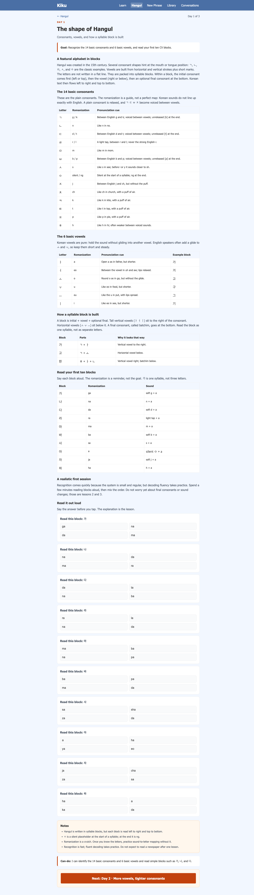
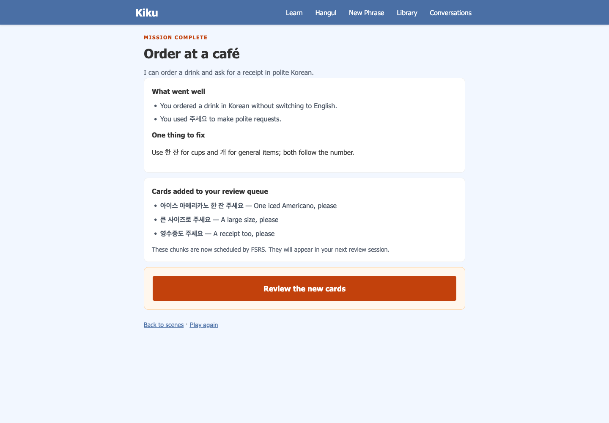
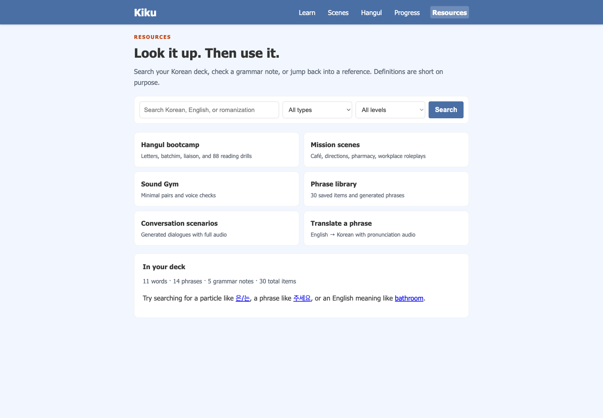
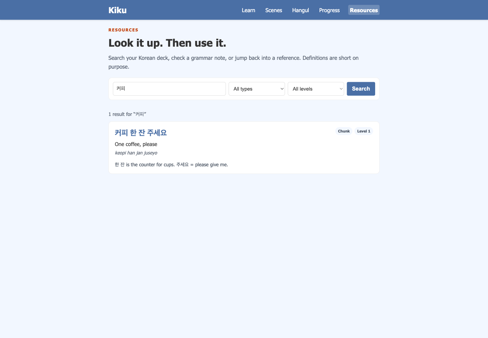

# Project Status — 23 November 2026

**Verdict:** a working single-user alpha with a real-time Korean voice teacher,
a Korean + Amharic review core, a dictionary and personal term library, and a
fidel bootcamp. Not ready for public use: no accounts, no pronunciation scoring,
and Amharic speech is unsupported by the current provider.

Current architecture: [`ARCHITECTURE.md`](ARCHITECTURE.md). Decisions:
[`architecture/00-decision-2026-11-23.md`](architecture/00-decision-2026-11-23.md).

---

## Historical detail — 20 October 2026

**Repository:** Korean Language Learner (working product name: **Kiku**)
**Verdict at the time:** Phase 0 (stabilize) complete; the first FSRS review loop working.

## What works today

- English → Korean translation via `gpt-4.1-nano`, with validated structured output
- Korean TTS via OpenAI `tts-1` (single voice, or two voices in conversations)
- Saved phrase library with pagination and audio playback
- Short 2–4 line conversation generation with per-line and merged audio
- **Onboarding:** goal, daily time, experience, timezone, and a first spoken 안녕하세요 with local-only recording
- **Learn loop:** `/learn` today view, `/learn/review` retrieval card, 1–4 grading, FSRS-6 scheduling, review log, and time-boxed 3/10/25-minute sessions
- **Seed deck:** 30 hand-curated Korean items (survival phrases, core nouns, five grammar patterns), one review card per item
- **Daily new-card cap:** 10 new cards per day; review cards are always prioritized
- **Hangul bootcamp:** seven lessons (letters, vowels/blocks, batchim, double batchim, signs/menus/numbers, connected speech, final reading check) with 88 interactive drills
- **Mission scenes:** four scripted roleplays (café, directions, pharmacy, workplace intro) with tolerant answer matching, hints, resumable progress, voice answers, and a debrief that adds three chunks to the review deck
- **Can-do proof:** completing a scene creates a dated “I can…” artifact, shown on the progress page and as the next mission on Today
- **Sound Gym:** 11 minimal-pair perception drills, 8 production prompts, local-only recording, and transcript-based speech checks
- **Speech evidence:** `SpeechAttempt` records what the model heard and a transcript-match score — explicitly not a pronunciation grade; raw audio is never stored
- **Alpha instrumentation:** append-only `Event` table and `flask metrics` for activation, review users, speech attempts, D1/D7
- **Resources:** searchable Korean/English/romanization/notes lookup with type and level filters, plus quick links to Hangul, scenes, Sound Gym, library, conversations, translation, and settings
- **Installable PWA:** web manifest, icons, install metadata, an app-shell service worker, and a cached offline fallback
- **Gentle reminders:** `/settings` stores goal, daily time, timezone, reminder on/off, and reminder time; browser push subscriptions are stored server-side; `flask send-reminders` delivers at most one due-card reminder per learner per local day and skips days with nothing due
- **Progress view:** skill breakdown, last-7-days activity, 7+/30+ day delayed-retention signal, can-do proof, recent reviews, practiced-card count
- **Local single-user mode:** a local `User` row scopes profile, review cards, and logs; real accounts are next
- CLI translation/TTS tool (`hangul.py`)
- `flask seed-content`, `flask media-audit`, `flask media-gc`
- **195 automated tests**, ruff clean, CI with an empty-database migration gate and push-schema assertions

## What changed in Phase 0

- OpenAI clients are lazy; the app, migrations, and tests boot without a key.
- Explicit connect/read timeouts and `max_retries=0`; only transient errors are retried, with backoff.
- Pydantic schemas validate requests and model output (line count, speakers, lengths, Hangul).
- Conversation rendering uses `createElement`/`textContent`; no model-controlled `innerHTML`.
- SQLite uses WAL, `busy_timeout=5000`, `foreign_keys=ON`.
- Audio is generated in a private staging directory and moved only after success; failed jobs leave zero rows and zero files.
- Alembic builds a fresh database from empty; the missing `phrase` baseline is repaired.
- Rate limiting is thread-safe, bounded, per-endpoint, proxy-aware, and returns `Retry-After`.
- API 404/415/500 responses are correct, include request IDs, and do not leak internals.
- Security headers (CSP, frame/referrer policies), optional basic-auth gate, localhost warning.
- README, `.env.example`, Makefile, and CI reflect reality.

## Current screens

| Today | Review |
|---|---|
|  |  |

| Answer revealed | Mobile |
|---|---|
|  |  |

| Onboarding | First spoken sentence |
|---|---|
|  |  |

| Hangul lessons | Hangul drills |
|---|---|
|  |  |

| Sound Gym | Mission scenes |
|---|---|
|  |  |

| Scene play | Scene debrief |
|---|---|
|  |  |

| Voice answer panel | Weekly progress |
|---|---|
|  |  |

| Resources | Resource search |
|---|---|
|  |  |

| Settings & reminders |
|---|
|  |

## What still does not exist

- Real user accounts, sessions, OAuth, and per-user data isolation (local single-user only)
- Postgres deployment; SQLite is still the default
- Placement test and an adaptive starting point (onboarding captures self-report only)
- Hangul typing drills and timed fluency coaching (the 7-lesson decoding curriculum is complete)
- Phoneme-level pronunciation scoring, prosody feedback, and calibrated L2 ASR (current checks are transcript-based)
- Native-reviewed audio for the seed deck, Sound Gym, and scene characters (browser TTS is a stopgap)
- Branching scene state and adaptive difficulty (scenes are scripted, 3 steps each)
- Native-reviewed character audio for scenes (browser TTS is a stopgap)
- Fuller grammar reference: parsed examples, register notes, and contrast pages beyond short item notes
- Streak repair, vacation mode, and a flexible habit system (a basic day streak exists)
- A full offline review queue (the PWA currently caches the shell and an offline fallback, not review data)
- Content pipeline: 30 items, 7 Hangul lessons, and 4 scenes only; no 20-scene library, no native review queue, no audio for seed items
- Speech/TTS cost controls beyond caching (no per-user budget)
- Postgres/Redis/multi-worker production setup

## Top risks

1. Content quality and breadth: 30 items is a demo, not a curriculum.
2. Single-user local mode; real accounts and per-user isolation are required before a public beta.
3. No native audio on seed items; browser speech synthesis is a temporary fallback.
4. Single-user local mode; auth and data isolation are required before any public deployment.
5. Transcript matching is useful evidence, not pronunciation scoring; phoneme/prosody feedback is still the hardest differentiator to build.
6. Reminder delivery needs a cron worker and HTTPS in production; the in-app loop works without it.

## Where to go next

- **Execution plan and status:** [`ROADMAP.md`](ROADMAP.md)
- **Product and learning design:** [`KIKU_BLUEPRINT.md`](KIKU_BLUEPRINT.md)
- **Full audit with file:line evidence:** [`research/01-codebase-audit.md`](research/01-codebase-audit.md)
- **Learning science:** [`research/02-learning-science.md`](research/02-learning-science.md)
- **Korean pedagogy:** [`research/03-korean-pedagogy.md`](research/03-korean-pedagogy.md)
- **Competitive teardown:** [`research/04-competitive-teardown.md`](research/04-competitive-teardown.md)
- **Architecture and AI:** [`research/05-tech-and-ai.md`](research/05-tech-and-ai.md)

**Immediate next sprint:** rotate the exposed key and run `flask generate-item-audio` → add phoneme evidence (Azure/SpeechSuper) behind the existing speech interface → real accounts + Postgres → 20 alpha users and a `flask metrics` review. Deploy `flask send-reminders` on a 5–15 minute cron once HTTPS is available.

---

## Update — 23 November 2026: multilingual foundation

Phase 1 of the language-neutral refactor is shipped. It is additive and has no
user-visible effect yet.

- **New tables:** `language`, `script`, `language_script`, `level_scale`,
  `course`, `deck`, `deck_item`, `item_form`, `item_gloss`,
  `dictionary_entry`, `dictionary_sense`, `translation`, `term_card`.
- **Language columns** added (nullable) to `item`, `phrase`, `conversation`,
  `user`, `speech_attempt`, `scene_session`, `can_do_artifact`, `event`.
- **Backfill:** all Korean items now have a Hangul citation form, an English
  gloss, `language_id=ko`, and `ko-core` deck membership; phrases carry
  `en→ko` source/target IDs and text.
- **Migrations:** `20261123_0011` (expand) and `20261123_0012` (backfill).
  Verified up from `20261019_0010` with live rows, down again with no data loss.
- **Ops:** `flask language-audit` reports coverage.
- **P0 fix:** `gpt-4.1-nano` was shut down on 23 Oct 2026; defaults moved to
  `gpt-5.6-luna`, with correct handling for reasoning-tier chat models.
- **Tests:** 202 pass; ruff clean; CI migration gate updated.

The plan, the Amharic recommendation, the teacher design, and the real-time
vendor decision are in
[`architecture/00-decision-2026-11-23.md`](architecture/00-decision-2026-11-23.md).

**Expiring models to migrate next:** `tts-1` shuts down 6 Jan 2027 and
`gpt-4o-transcribe` on 26 Feb 2027; both need the provider boundary before
then.

### Voice teacher (same day)

- `/learn/teacher` runs a real two-way voice lesson through OpenAI Realtime
  (`gpt-realtime-2.1-mini`) with Korean transcription, live transcript,
  on-demand drills, a personal term library, and an end-of-session debrief.
- Six allowlisted teacher tools write through the app: due items, dictionary
  lookup, create drill, save term, log attempt (creates a `produce` FSRS card),
  and end-summary.
- New tables `teacher_session`, `teacher_turn`, `drill`, `drill_attempt`
  (migration `20261123_0013`). No raw audio is stored.
- `gpt-transcribe` replaces the retiring `gpt-4o-transcribe` for speech checks.
- 211 tests pass; the teacher page renders on the migrated local database.
- Remaining deadline: pre-generated item audio still uses `tts-1` (shutdown
  6 Jan 2027). Live teacher voice does not depend on it.

### OpenAI-only cleanup and Amharic (same day)

- Pre-generated audio moved from `tts-1` to `gpt-audio-1.5` through Chat
  Completions. No Gemini key and no `/v1/audio/speech` dependency.
- `TEACHER_DAILY_MINUTES` and `TEACHER_MAX_SESSION_MINUTES` are enforced; new
  sessions return 429 when the daily budget is spent.
- Amharic (`am`) is active with a 64-item survival deck, Ge'ez forms and
  transliterations, review cards, and a six-lesson **Fidel** bootcamp at
  `/learn/fidel`.
- Settings → Learning switches between Korean and Amharic; review and progress
  are scoped per language.
- The voice teacher remains Korean-only because OpenAI Realtime does not
  support Amharic speech; the UI states this.
- Amharic content is starter material pending native review.

### Live verification and completion pass (same day)

- Verified with a valid key: all four models accessible; EN→KO and EN→AM
  translation; KO and AM TTS; KO ASR; realtime WebSocket audio, transcript,
  and a real tool call; exact teacher config accepted by the realtime API.
- TTS now rejects conversational drift instead of saving the wrong audio.
- Added a language-scoped dictionary with save-to-library, a “My terms”
  library section, and post-call drill grading that schedules FSRS cards.
- Translation is generic by target language with script validation.
- Generated audio for all 64 Amharic items; resources, progress, and review are
  scoped per language.
- Remaining: browser WebRTC SDP test, Amharic speech (unsupported by OpenAI),
  accounts, pronunciation scoring, and content depth.

### Documentation and agent guidance (same day)

- Added root `AGENTS.md`: commands, invariants, decision table, workflows, and
  definition of done for coding agents.
- Added `docs/ARCHITECTURE.md`: current module map, data model, request flows,
  legacy-column mapping, language support matrix, and structural debt.
- Rewrote `README.md` to match the product (teacher, Amharic, dictionary,
  current models).
- Marked `KIKU_BLUEPRINT.md` and `ROADMAP.md` as historical and pointed them at
  the current decision record.
- Consolidated text normalization into `app/utils/text.py`; added
  `Item.target_text` / `Item.gloss` accessors for the legacy columns.
- Korean-only scenes, Hangul, Sound Gym, and conversations now redirect or
  reject for Amharic instead of silently serving Korean content.

### Structural refactor (same day)

- **Column contract** migration `20261123_0014` renamed `item.korean` →
  `target_text`, `item.english` → `gloss`, `item.romanization` →
  `transliteration`; `phrase` now uses only `source_text`/`target_text`.
  Verified up and down on a copy with real rows, then applied to the live
  database; all 94 items and 13 phrases preserved.
- **Language-explicit URLs**: every learner page now lives under `/<lang_code>/`
  (`/ko/learn`, `/am/learn`, `/am/dictionary`, …). A URL preprocessor sets
  `g.language`; `url_for` fills `lang_code` automatically. Legacy paths such as
  `/learn` and `/settings` 301-redirect to the active language. Unprefixed APIs
  accept `?lang=` or a JSON `lang` field.
- **Route split**: `app/routes.py` is gone. The `main` blueprint now lives in
  `app/main/` (`home`, `content`, `settings`, `system`, `translate`,
  `conversations`, shared `helpers`). Endpoint names are unchanged.
- **Dead compatibility code removed**: the Korean-only `TranslationResponse`
  schema and `korean_translation` alias are gone.
- **Onboarding is language-aware** for Korean and Amharic (first word, script
  wording, goal filtering).
- Full suite and ruff pass; `/`, `/ko/*`, `/am/*`, translation, dictionary, and
  teacher pages all render against the migrated live database.

### Browser end-to-end pass (same day)

Tested in Chrome against `127.0.0.1:5000`:

- Home translation (EN→KO) with generated audio; Learn → review → grade; dictionary
  search → save term → library; resources search; settings language switch
  (KO→AM→KO) with correct URL redirect; Amharic review, dictionary, and fidel
  drill (typing, feedback, progress); scenes (café step 1→2); Hangul lesson;
  Sound Gym; progress; legacy path redirects; 404 page; mobile viewport.
- **Live teacher verified in the browser**: mic permission, WebRTC connected in
  under a second, real audio and two-way transcript, clean end, and debrief.
- Fixed during the pass: hidden loading spinner was visible; fidel JSON was
  double-escaped so the drill never started; Ethiopic text needed a bundled
  Noto font; fidel answers asked for a bare vowel instead of the full syllable;
  `/ko/library` leaked Amharic saved translations; settings still said
  “Everyday Korean” and showed TOPIK for Amharic; teacher end status raced to
  “disconnected” after a clean end.
- Browser console clean on all pages; no server 500/502s. Teacher tool calls
  were already verified over the realtime WebSocket; the browser call verifies
  the WebRTC transport, audio, transcripts, and lifecycle.

### UI, guidance, and accessibility pass (same day)

- Responsive navigation: brand link, disclosure menu under 900px with
  `aria-expanded`/`aria-controls`, Escape to close, Settings exposed in the
  nav, and `aria-current` on every item.
- Page framing: `page-hero`, language badge, consistent cards, footer with
  privacy note, and one `<h1>` per page.
- First-run guidance: dismissible three-step cards on Learn and Teacher,
  accessible `
` help for “due”, the four ratings, saving terms, fidel
  vowel orders, and what to ask the teacher. Dismissal is stored locally.
- Dictionary: no longer dumps the whole deck on load. It shows suggested
  searches, “Browse the whole deck”, a result count, and a clear empty state.
- Fidel: progress bar, live feedback, and a grid explanation.
- Accessibility audit in-browser: every page has one h1 and one main, no
  duplicate IDs, no unlabelled form controls, no unnamed buttons/links, no
  images without alt text, no horizontal overflow at 390px.
- Mobile and desktop screenshots verified in Chrome; console clean.

### Information architecture and design system (same day)

- **Home is Today.** `/` and `/<lang>/` land on `/<lang>/learn`; the phrase
  translator moved to `/<lang>/translate` under the **Words** group.
- **Navigation is grouped** into Learn / Practice / Words / Settings instead of
  eight flat links. The current language is a persistent header select that
  changes language and lands on Today.
- **My terms is discoverable** from the header, from a Today card with the saved
  count and preview, and from the dictionary. The page is now “Words you kept.”
- **Design tokens**: primitive palette → semantic colors → spacing, radius,
  elevation, type, and motion scales. New components use tokens; legacy CSS is
  migrated opportunistically. Tailwind was deliberately not added (see
  `docs/DESIGN.md`); the framework remains Flask + Jinja + vanilla JS + plain CSS.
- **Live style guide** at `/design` documents tokens and components.
- Browser-tested desktop and 390px mobile: grouped menus, language switch
  KO↔AM, My terms navigation, no overflow, no console errors.
