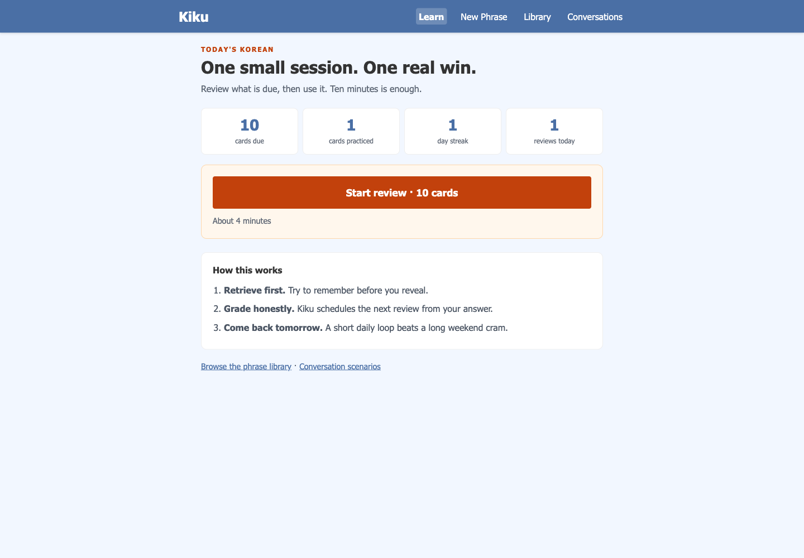
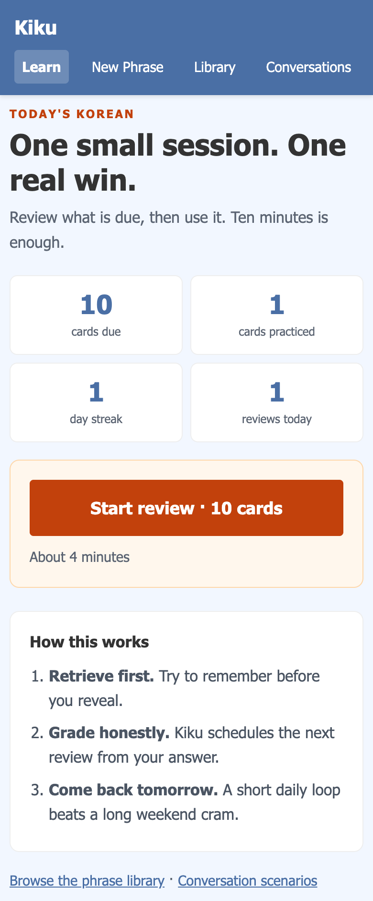
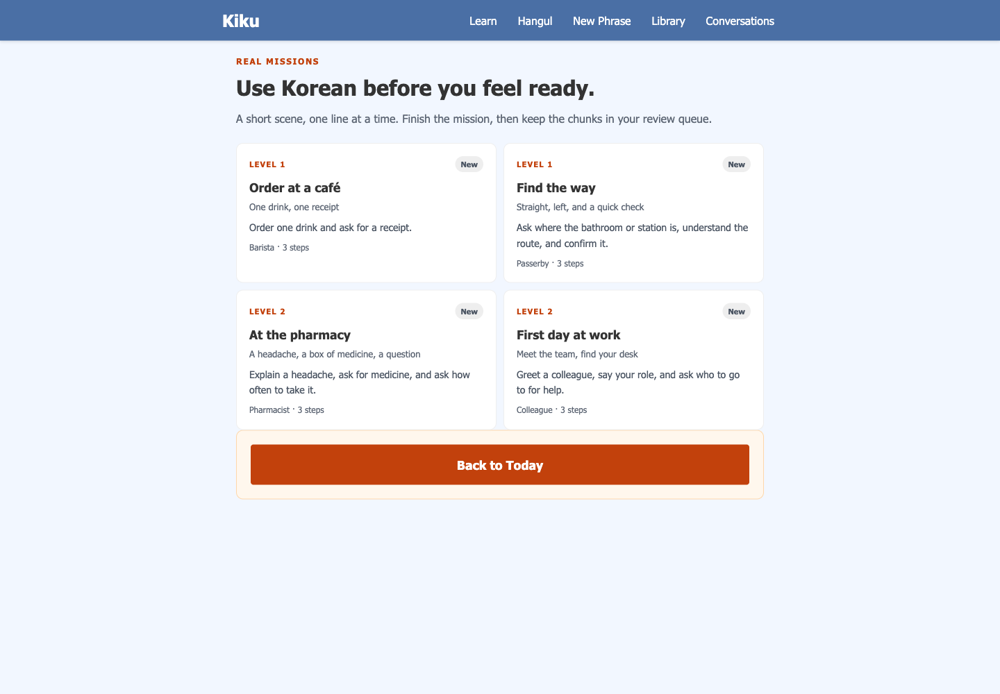
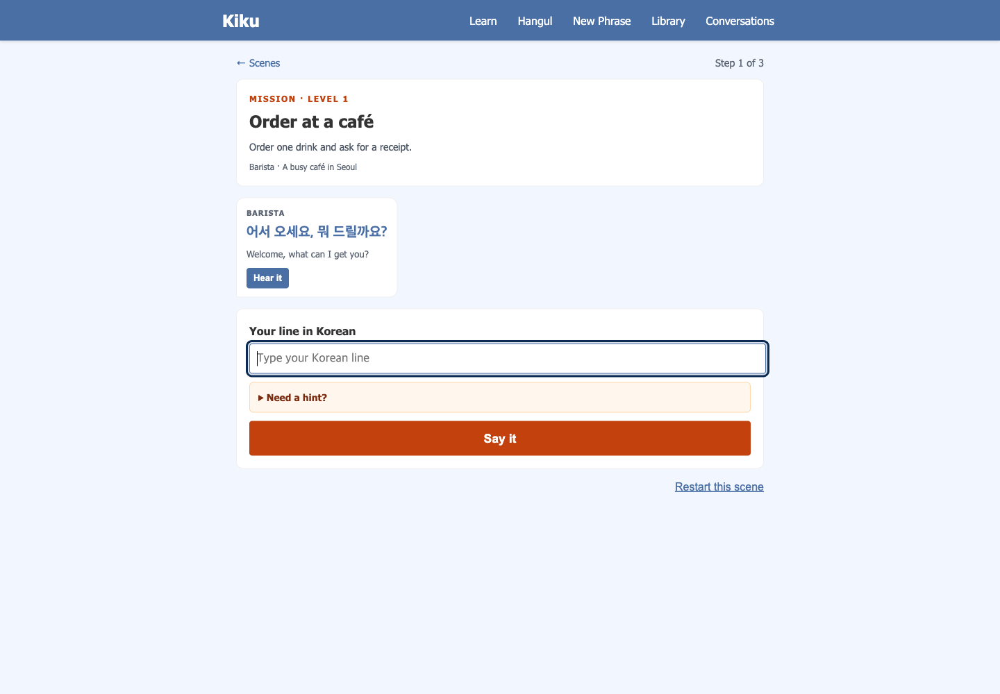

# Project Status — 19 October 2026

**Repository:** Korean Language Learner (working product name: **Kiku**)
**Verdict:** Phase 0 (stabilize) is complete except user key rotation. The first Phase 1 vertical slice — a real FSRS review loop — is working.

## What works today

- English → Korean translation via `gpt-4.1-nano`, with validated structured output
- Korean TTS via OpenAI `tts-1` (single voice, or two voices in conversations)
- Saved phrase library with pagination and audio playback
- Short 2–4 line conversation generation with per-line and merged audio
- **Onboarding:** goal, daily time, experience, timezone, and a first spoken 안녕하세요 with local-only recording
- **Learn loop:** `/learn` today view, `/learn/review` retrieval card, 1–4 grading, FSRS-6 scheduling, review log
- **Seed deck:** 30 hand-curated Korean items (survival phrases, core nouns, five grammar patterns), one review card per item
- **Daily new-card cap:** 10 new cards per day; review cards are always prioritized
- **Hangul bootcamp:** seven lessons (letters, vowels/blocks, batchim, double batchim, signs/menus/numbers, connected speech, final reading check) with 88 interactive drills
- **Mission scenes:** four scripted roleplays (café, directions, pharmacy, workplace intro) with tolerant answer matching, hints, resumable progress, voice answers, and a debrief that adds three chunks to the review deck
- **Sound Gym:** 11 minimal-pair perception drills, 8 production prompts, local-only recording, and transcript-based speech checks
- **Speech evidence:** `SpeechAttempt` records what the model heard and a transcript-match score — explicitly not a pronunciation grade; raw audio is never stored
- **Alpha instrumentation:** append-only `Event` table and `flask metrics` for activation, review users, speech attempts, D1/D7
- **Progress view:** skill breakdown, recent reviews, practiced-card count
- **Local single-user mode:** a local `User` row scopes profile, review cards, and logs; real accounts are next
- CLI translation/TTS tool (`hangul.py`)
- `flask seed-content`, `flask media-audit`, `flask media-gc`
- **173 automated tests**, ruff clean, CI with an empty-database migration gate

## What changed in Phase 0

- OpenAI clients are lazy; the app, migrations, and tests boot without a key.
- Explicit connect/read timeouts and `max_retries=0`; only transient errors are retried, with backoff.
- Pydantic schemas validate requests and model output (line count, speakers, lengths, Hangul).
- Conversation rendering uses `createElement`/`textContent`; no model-controlled `innerHTML`.
- SQLite uses WAL, `busy_timeout=5000`, `foreign_keys=ON`.
- Audio is generated in a private staging directory and moved only after success; failed jobs leave zero rows and zero files.
- Alembic builds a fresh database from empty; the missing `phrase` baseline is repaired.
- Rate limiting is thread-safe, bounded, per-endpoint, proxy-aware, and returns `Retry-After`.
- API 404/415/500 responses are correct, include request IDs, and do not leak internals.
- Security headers (CSP, frame/referrer policies), optional basic-auth gate, localhost warning.
- README, `.env.example`, Makefile, and CI reflect reality.

## Current screens

| Today | Review |
|---|---|
|  |  |

| Answer revealed | Mobile |
|---|---|
|  |  |

| Onboarding | First spoken sentence |
|---|---|
|  |  |

| Hangul lessons | Hangul drills |
|---|---|
|  |  |

| Sound Gym | Mission scenes |
|---|---|
|  |  |

| Scene play | Scene debrief |
|---|---|
|  |  |

| Voice answer panel |
|---|
|  |

## What still does not exist

- Real user accounts, sessions, OAuth, and per-user data isolation (local single-user only)
- Postgres deployment; SQLite is still the default
- Placement test and an adaptive starting point (onboarding captures self-report only)
- Hangul typing drills and timed fluency coaching (the 7-lesson decoding curriculum is complete)
- Phoneme-level pronunciation scoring, prosody feedback, and calibrated L2 ASR (current checks are transcript-based)
- Native-reviewed audio for the seed deck, Sound Gym, and scene characters (browser TTS is a stopgap)
- Branching scene state and adaptive difficulty (scenes are scripted, 3 steps each)
- Native-reviewed character audio for scenes (browser TTS is a stopgap)
- Grammar explanation UI beyond short notes on seed items
- Can-do artifacts, full skill map, retention dashboard, weekly recap
- Streak repair, reminders, notifications, vacation mode, and a flexible habit system (a basic day streak exists)
- PWA/offline support
- Content pipeline: 30 items and 3 Hangul lessons only; no 20-scene library, no native review queue, no audio for seed items
- Speech/TTS cost controls beyond caching (no per-user budget)
- Postgres/Redis/multi-worker production setup

## Top risks

1. Content quality and breadth: 30 items is a demo, not a curriculum.
2. No onboarding or first-spoken-sentence experience yet.
3. No audio on seed items; browser speech synthesis is a temporary fallback.
4. Single-user local mode; auth and data isolation are required before any public deployment.
5. No speech/pronunciation loop yet; this is the main differentiator and the hardest build.
6. No retention instrumentation; the next step is 20 alpha users and real D1/D7 data.

## Where to go next

- **Execution plan and status:** [`ROADMAP.md`](ROADMAP.md)
- **Product and learning design:** [`KIKU_BLUEPRINT.md`](KIKU_BLUEPRINT.md)
- **Full audit with file:line evidence:** [`research/01-codebase-audit.md`](research/01-codebase-audit.md)
- **Learning science:** [`research/02-learning-science.md`](research/02-learning-science.md)
- **Korean pedagogy:** [`research/03-korean-pedagogy.md`](research/03-korean-pedagogy.md)
- **Competitive teardown:** [`research/04-competitive-teardown.md`](research/04-competitive-teardown.md)
- **Architecture and AI:** [`research/05-tech-and-ai.md`](research/05-tech-and-ai.md)

**Immediate next sprint:** run `flask generate-item-audio` after rotating the key to pre-generate the 30 seed MP3s → wire speech answers into scenes → add phoneme evidence (Azure/SpeechSuper) behind the existing speech interface → 20 alpha users and a `flask metrics` review.
