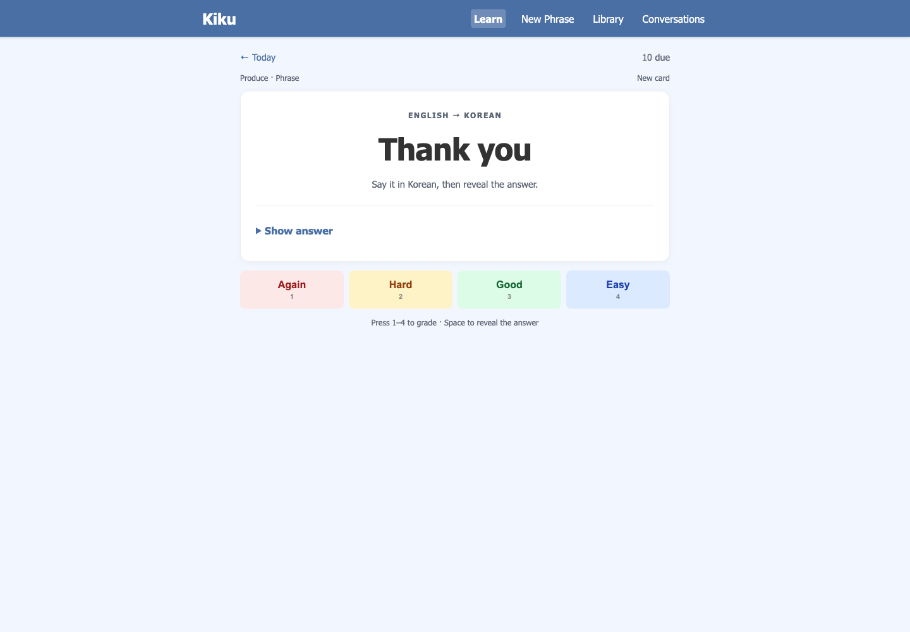
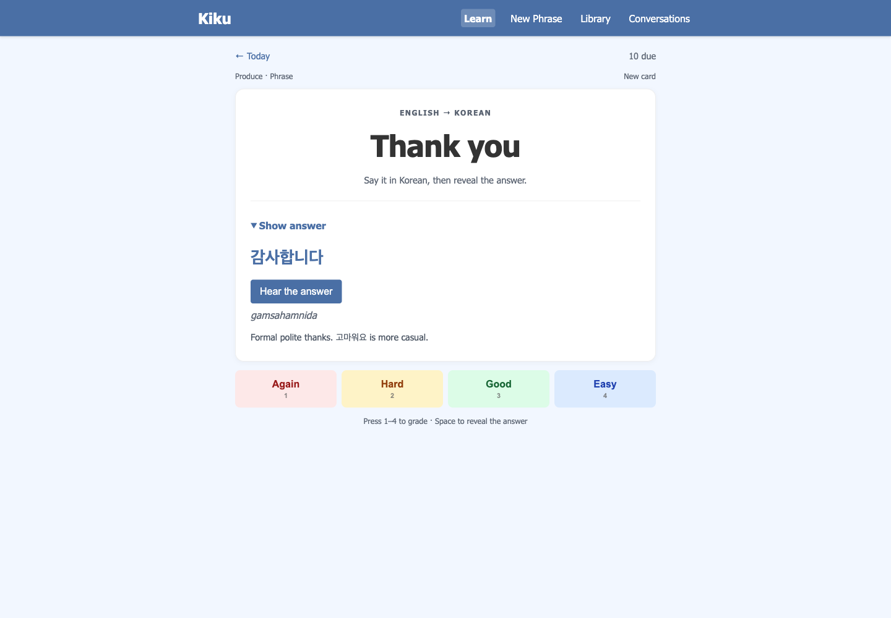
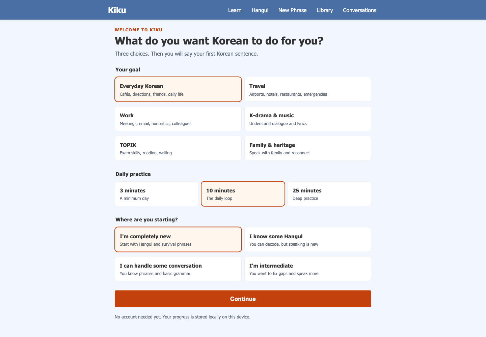
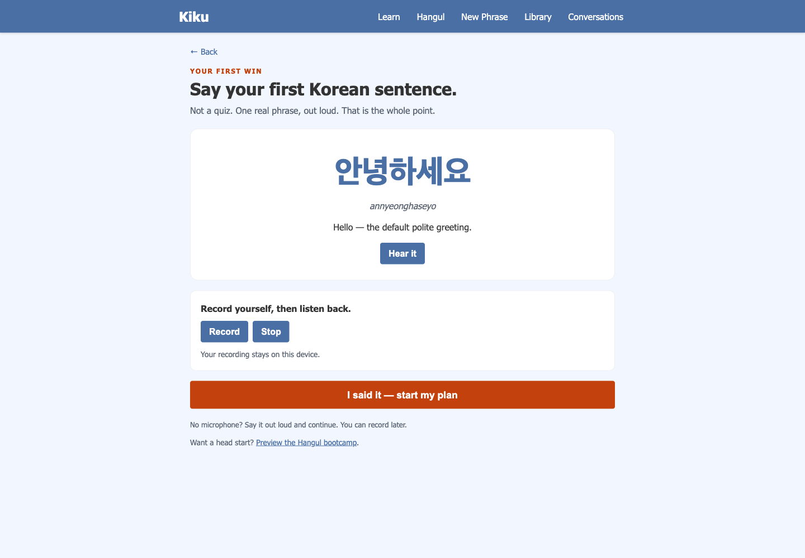
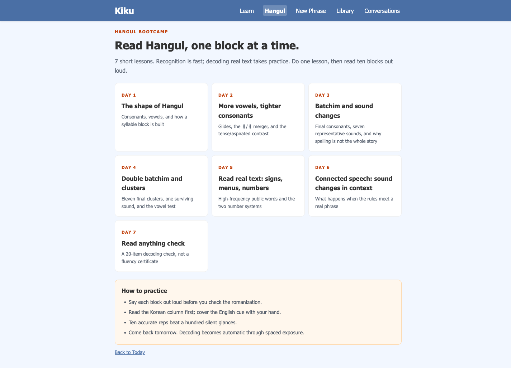
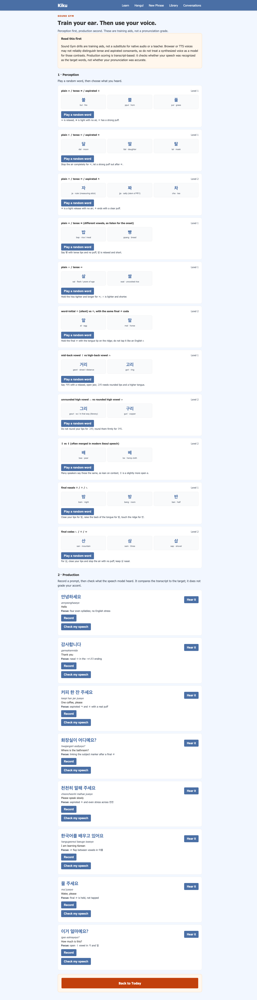
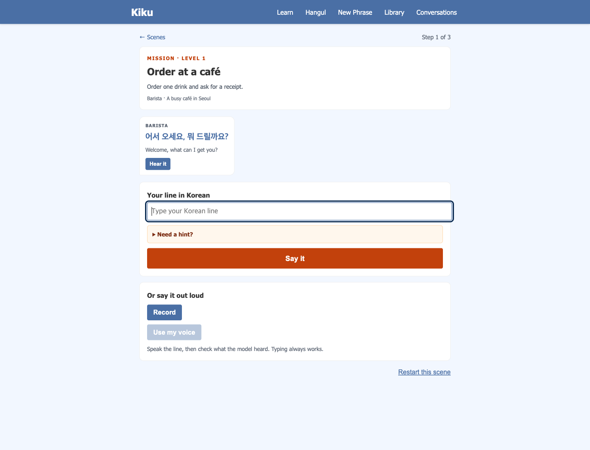
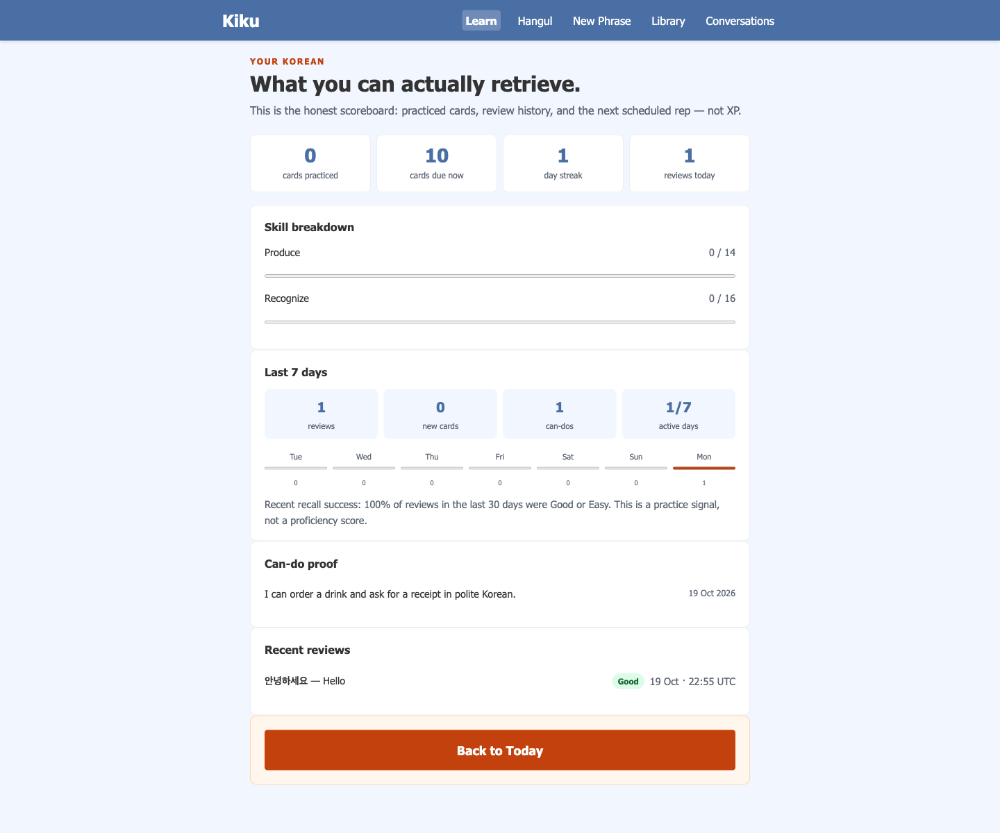
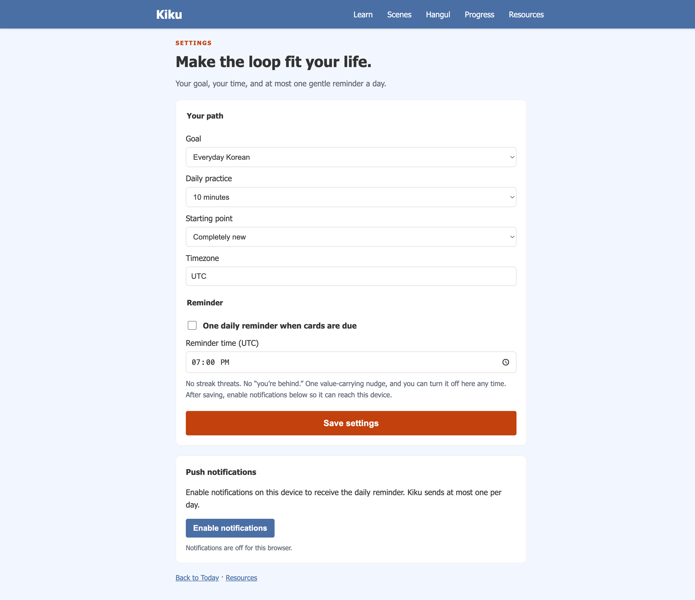

# Project Status — 25 November 2026

**Verdict:** a working single-user alpha with a real-time Korean voice teacher,
a Korean + Amharic review core, a dictionary and personal term library, and a
fidel bootcamp. Not ready for public use: no accounts, no pronunciation scoring,
and Amharic speech is unsupported by the current provider.

Current architecture: [`ARCHITECTURE.md`](ARCHITECTURE.md). Decisions:
[`architecture/00-decision-2026-11-23.md`](architecture/00-decision-2026-11-23.md).

---

## Historical detail — 20 October 2026

**Repository:** [language-learner](https://github.com/riefer02/language-learner) (product name: **Kiku**)
**Verdict at the time:** Phase 0 (stabilize) complete; the first FSRS review loop working.

## What works today

- English → Korean translation via `gpt-4.1-nano`, with validated structured output
- Korean TTS via OpenAI `tts-1` (single voice, or two voices in conversations)
- Saved phrase library with pagination and audio playback
- Short 2–4 line conversation generation with per-line and merged audio
- **Onboarding:** goal, daily time, experience, timezone, and a first spoken 안녕하세요 with local-only recording
- **Learn loop:** `/learn` today view, `/learn/review` retrieval card, 1–4 grading, FSRS-6 scheduling, review log, and time-boxed 3/10/25-minute sessions
- **Seed deck:** 30 hand-curated Korean items (survival phrases, core nouns, five grammar patterns), one review card per item
- **Daily new-card cap:** 10 new cards per day; review cards are always prioritized
- **Hangul bootcamp:** seven lessons (letters, vowels/blocks, batchim, double batchim, signs/menus/numbers, connected speech, final reading check) with 88 interactive drills
- **Mission scenes:** four scripted roleplays (café, directions, pharmacy, workplace intro) with tolerant answer matching, hints, resumable progress, voice answers, and a debrief that adds three chunks to the review deck
- **Can-do proof:** completing a scene creates a dated “I can…” artifact, shown on the progress page and as the next mission on Today
- **Sound Gym:** 11 minimal-pair perception drills, 8 production prompts, local-only recording, and transcript-based speech checks
- **Speech evidence:** `SpeechAttempt` records what the model heard and a transcript-match score — explicitly not a pronunciation grade; raw audio is never stored
- **Alpha instrumentation:** append-only `Event` table and `flask metrics` for activation, review users, speech attempts, D1/D7
- **Resources:** searchable Korean/English/romanization/notes lookup with type and level filters, plus quick links to Hangul, scenes, Sound Gym, library, conversations, translation, and settings
- **Installable PWA:** web manifest, icons, install metadata, an app-shell service worker, and a cached offline fallback
- **Gentle reminders:** `/settings` stores goal, daily time, timezone, reminder on/off, and reminder time; browser push subscriptions are stored server-side; `flask send-reminders` delivers at most one due-card reminder per learner per local day and skips days with nothing due
- **Progress view:** skill breakdown, last-7-days activity, 7+/30+ day delayed-retention signal, can-do proof, recent reviews, practiced-card count
- **Local single-user mode:** a local `User` row scopes profile, review cards, and logs; real accounts are next
- CLI translation/TTS tool (`hangul.py`)
- `flask seed-content`, `flask media-audit`, `flask media-gc`
- **195 automated tests**, ruff clean, CI with an empty-database migration gate and push-schema assertions

## What changed in Phase 0

- OpenAI clients are lazy; the app, migrations, and tests boot without a key.
- Explicit connect/read timeouts and `max_retries=0`; only transient errors are retried, with backoff.
- Pydantic schemas validate requests and model output (line count, speakers, lengths, Hangul).
- Conversation rendering uses `createElement`/`textContent`; no model-controlled `innerHTML`.
- SQLite uses WAL, `busy_timeout=5000`, `foreign_keys=ON`.
- Audio is generated in a private staging directory and moved only after success; failed jobs leave zero rows and zero files.
- Alembic builds a fresh database from empty; the missing `phrase` baseline is repaired.
- Rate limiting is thread-safe, bounded, per-endpoint, proxy-aware, and returns `Retry-After`.
- API 404/415/500 responses are correct, include request IDs, and do not leak internals.
- Security headers (CSP, frame/referrer policies), optional basic-auth gate, localhost warning.
- README, `.env.example`, Makefile, and CI reflect reality.

## Current screens

| Today | Review |
|---|---|
|  |  |

| Answer revealed | Mobile |
|---|---|
|  |  |

| Onboarding | First spoken sentence |
|---|---|
|  |  |

| Hangul lessons | Hangul drills |
|---|---|
|  |  |

| Sound Gym | Mission scenes |
|---|---|
|  |  |

| Scene play | Scene debrief |
|---|---|
|  |  |

| Voice answer panel | Weekly progress |
|---|---|
|  |  |

| Resources | Resource search |
|---|---|
|  |  |

| Settings & reminders |
|---|
|  |

## What still does not exist

- Real user accounts, sessions, OAuth, and per-user data isolation (local single-user only)
- Postgres deployment; SQLite is still the default
- Placement test and an adaptive starting point (onboarding captures self-report only)
- Hangul typing drills and timed fluency coaching (the 7-lesson decoding curriculum is complete)
- Phoneme-level pronunciation scoring, prosody feedback, and calibrated L2 ASR (current checks are transcript-based)
- Native-reviewed audio for the seed deck, Sound Gym, and scene characters (browser TTS is a stopgap)
- Branching scene state and adaptive difficulty (scenes are scripted, 3 steps each)
- Native-reviewed character audio for scenes (browser TTS is a stopgap)
- Fuller grammar reference: parsed examples, register notes, and contrast pages beyond short item notes
- Streak repair, vacation mode, and a flexible habit system (a basic day streak exists)
- A full offline review queue (the PWA currently caches the shell and an offline fallback, not review data)
- Content pipeline: 30 items, 7 Hangul lessons, and 4 scenes only; no 20-scene library, no native review queue, no audio for seed items
- Speech/TTS cost controls beyond caching (no per-user budget)
- Postgres/Redis/multi-worker production setup

## Top risks

1. Content quality and breadth: 30 items is a demo, not a curriculum.
2. Single-user local mode; real accounts and per-user isolation are required before a public beta.
3. No native audio on seed items; browser speech synthesis is a temporary fallback.
4. Single-user local mode; auth and data isolation are required before any public deployment.
5. Transcript matching is useful evidence, not pronunciation scoring; phoneme/prosody feedback is still the hardest differentiator to build.
6. Reminder delivery needs a cron worker and HTTPS in production; the in-app loop works without it.

## Where to go next

- **Execution plan and status:** [`ROADMAP.md`](ROADMAP.md)
- **Product and learning design:** [`KIKU_BLUEPRINT.md`](KIKU_BLUEPRINT.md)
- **Full audit with file:line evidence:** [`research/01-codebase-audit.md`](research/01-codebase-audit.md)
- **Learning science:** [`research/02-learning-science.md`](research/02-learning-science.md)
- **Korean pedagogy:** [`research/03-korean-pedagogy.md`](research/03-korean-pedagogy.md)
- **Competitive teardown:** [`research/04-competitive-teardown.md`](research/04-competitive-teardown.md)
- **Architecture and AI:** [`research/05-tech-and-ai.md`](research/05-tech-and-ai.md)

**Immediate next sprint:** rotate the exposed key and run `flask generate-item-audio` → add phoneme evidence (Azure/SpeechSuper) behind the existing speech interface → real accounts + Postgres → 20 alpha users and a `flask metrics` review. Deploy `flask send-reminders` on a 5–15 minute cron once HTTPS is available.

---

## Update — 23 November 2026: multilingual foundation

Phase 1 of the language-neutral refactor is shipped. It is additive and has no
user-visible effect yet.

- **New tables:** `language`, `script`, `language_script`, `level_scale`,
  `course`, `deck`, `deck_item`, `item_form`, `item_gloss`,
  `dictionary_entry`, `dictionary_sense`, `translation`, `term_card`.
- **Language columns** added (nullable) to `item`, `phrase`, `conversation`,
  `user`, `speech_attempt`, `scene_session`, `can_do_artifact`, `event`.
- **Backfill:** all Korean items now have a Hangul citation form, an English
  gloss, `language_id=ko`, and `ko-core` deck membership; phrases carry
  `en→ko` source/target IDs and text.
- **Migrations:** `20261123_0011` (expand) and `20261123_0012` (backfill).
  Verified up from `20261019_0010` with live rows, down again with no data loss.
- **Ops:** `flask language-audit` reports coverage.
- **P0 fix:** `gpt-4.1-nano` was shut down on 23 Oct 2026; defaults moved to
  `gpt-5.6-luna`, with correct handling for reasoning-tier chat models.
- **Tests:** 202 pass; ruff clean; CI migration gate updated.

The plan, the Amharic recommendation, the teacher design, and the real-time
vendor decision are in
[`architecture/00-decision-2026-11-23.md`](architecture/00-decision-2026-11-23.md).

**Expiring models to migrate next:** `tts-1` shuts down 6 Jan 2027 and
`gpt-4o-transcribe` on 26 Feb 2027; both need the provider boundary before
then.

### Voice teacher (same day)

- `/learn/teacher` runs a real two-way voice lesson through OpenAI Realtime
  (`gpt-realtime-2.1-mini`) with Korean transcription, live transcript,
  on-demand drills, a personal term library, and an end-of-session debrief.
- Six allowlisted teacher tools write through the app: due items, dictionary
  lookup, create drill, save term, log attempt (creates a `produce` FSRS card),
  and end-summary.
- New tables `teacher_session`, `teacher_turn`, `drill`, `drill_attempt`
  (migration `20261123_0013`). No raw audio is stored.
- `gpt-transcribe` replaces the retiring `gpt-4o-transcribe` for speech checks.
- 211 tests pass; the teacher page renders on the migrated local database.
- Remaining deadline: pre-generated item audio still uses `tts-1` (shutdown
  6 Jan 2027). Live teacher voice does not depend on it.

### OpenAI-only cleanup and Amharic (same day)

- Pre-generated audio moved from `tts-1` to `gpt-audio-1.5` through Chat
  Completions. No Gemini key and no `/v1/audio/speech` dependency.
- `TEACHER_DAILY_MINUTES` and `TEACHER_MAX_SESSION_MINUTES` are enforced; new
  sessions return 429 when the daily budget is spent.
- Amharic (`am`) is active with a 64-item survival deck, Ge'ez forms and
  transliterations, review cards, and a six-lesson **Fidel** bootcamp at
  `/learn/fidel`.
- Settings → Learning switches between Korean and Amharic; review and progress
  are scoped per language.
- The voice teacher remains Korean-only because OpenAI Realtime does not
  support Amharic speech; the UI states this. *(Superseded 26 November: the
  teacher now runs in Amharic, transcription through auto-detect. The spoken
  quality is still unverified by a live call.)*
- Amharic content is starter material pending native review.

### Live verification and completion pass (same day)

- Verified with a valid key: all four models accessible; EN→KO and EN→AM
  translation; KO and AM TTS; KO ASR; realtime WebSocket audio, transcript,
  and a real tool call; exact teacher config accepted by the realtime API.
- TTS now rejects conversational drift instead of saving the wrong audio.
- Added a language-scoped dictionary with save-to-library, a “My terms”
  library section, and post-call drill grading that schedules FSRS cards.
- Translation is generic by target language with script validation.
- Generated audio for all 64 Amharic items; resources, progress, and review are
  scoped per language.
- Remaining: browser WebRTC SDP test, Amharic speech (unsupported by OpenAI),
  accounts, pronunciation scoring, and content depth.

### Documentation and agent guidance (same day)

- Added root `AGENTS.md`: commands, invariants, decision table, workflows, and
  definition of done for coding agents.
- Added `docs/ARCHITECTURE.md`: current module map, data model, request flows,
  legacy-column mapping, language support matrix, and structural debt.
- Rewrote `README.md` to match the product (teacher, Amharic, dictionary,
  current models).
- Marked `KIKU_BLUEPRINT.md` and `ROADMAP.md` as historical and pointed them at
  the current decision record.
- Consolidated text normalization into `app/utils/text.py`; added
  `Item.target_text` / `Item.gloss` accessors for the legacy columns.
- Korean-only scenes, Hangul, Sound Gym, and conversations now redirect or
  reject for Amharic instead of silently serving Korean content.

### Structural refactor (same day)

- **Column contract** migration `20261123_0014` renamed `item.korean` →
  `target_text`, `item.english` → `gloss`, `item.romanization` →
  `transliteration`; `phrase` now uses only `source_text`/`target_text`.
  Verified up and down on a copy with real rows, then applied to the live
  database; all 94 items and 13 phrases preserved.
- **Language-explicit URLs**: every learner page now lives under `/<lang_code>/`
  (`/ko/learn`, `/am/learn`, `/am/dictionary`, …). A URL preprocessor sets
  `g.language`; `url_for` fills `lang_code` automatically. Legacy paths such as
  `/learn` and `/settings` 301-redirect to the active language. Unprefixed APIs
  accept `?lang=` or a JSON `lang` field.
- **Route split**: `app/routes.py` is gone. The `main` blueprint now lives in
  `app/main/` (`home`, `content`, `settings`, `system`, `translate`,
  `conversations`, shared `helpers`). Endpoint names are unchanged.
- **Dead compatibility code removed**: the Korean-only `TranslationResponse`
  schema and `korean_translation` alias are gone.
- **Onboarding is language-aware** for Korean and Amharic (first word, script
  wording, goal filtering).
- Full suite and ruff pass; `/`, `/ko/*`, `/am/*`, translation, dictionary, and
  teacher pages all render against the migrated live database.

### Browser end-to-end pass (same day)

Tested in Chrome against `127.0.0.1:5000`:

- Home translation (EN→KO) with generated audio; Learn → review → grade; dictionary
  search → save term → library; resources search; settings language switch
  (KO→AM→KO) with correct URL redirect; Amharic review, dictionary, and fidel
  drill (typing, feedback, progress); scenes (café step 1→2); Hangul lesson;
  Sound Gym; progress; legacy path redirects; 404 page; mobile viewport.
- **Live teacher verified in the browser**: mic permission, WebRTC connected in
  under a second, real audio and two-way transcript, clean end, and debrief.
- Fixed during the pass: hidden loading spinner was visible; fidel JSON was
  double-escaped so the drill never started; Ethiopic text needed a bundled
  Noto font; fidel answers asked for a bare vowel instead of the full syllable;
  `/ko/library` leaked Amharic saved translations; settings still said
  “Everyday Korean” and showed TOPIK for Amharic; teacher end status raced to
  “disconnected” after a clean end.
- Browser console clean on all pages; no server 500/502s. Teacher tool calls
  were already verified over the realtime WebSocket; the browser call verifies
  the WebRTC transport, audio, transcripts, and lifecycle.

### UI, guidance, and accessibility pass (same day)

- Responsive navigation: brand link, disclosure menu under 900px with
  `aria-expanded`/`aria-controls`, Escape to close, Settings exposed in the
  nav, and `aria-current` on every item.
- Page framing: `page-hero`, language badge, consistent cards, footer with
  privacy note, and one `<h1>` per page.
- First-run guidance: dismissible three-step cards on Learn and Teacher,
  accessible `
` help for “due”, the four ratings, saving terms, fidel
  vowel orders, and what to ask the teacher. Dismissal is stored locally.
- Dictionary: no longer dumps the whole deck on load. It shows suggested
  searches, “Browse the whole deck”, a result count, and a clear empty state.
- Fidel: progress bar, live feedback, and a grid explanation.
- Accessibility audit in-browser: every page has one h1 and one main, no
  duplicate IDs, no unlabelled form controls, no unnamed buttons/links, no
  images without alt text, no horizontal overflow at 390px.
- Mobile and desktop screenshots verified in Chrome; console clean.

### Information architecture and design system (same day)

- **Home is Today.** `/` and `/<lang>/` land on `/<lang>/learn`; the phrase
  translator moved to `/<lang>/translate` under the **Words** group.
- **Navigation is grouped** into Learn / Practice / Words / Settings instead of
  eight flat links. The current language is a persistent header select that
  changes language and lands on Today.
- **My terms is discoverable** from the header, from a Today card with the saved
  count and preview, and from the dictionary. The page is now “Words you kept.”
- **Design tokens**: primitive palette → semantic colors → spacing, radius,
  elevation, type, and motion scales. New components use tokens; legacy CSS is
  migrated opportunistically. Tailwind was deliberately not added (see
  `docs/DESIGN.md`); the framework remains Flask + Jinja + vanilla JS + plain CSS.
- **Live style guide** at `/design` documents tokens and components.
- Browser-tested desktop and 390px mobile: grouped menus, language switch
  KO↔AM, My terms navigation, no overflow, no console errors.

### Adversarial review pass (same day)

Three parallel reviews (code, design/accessibility, security/deployment) ran
read-only. Fixes shipped:

- **Safety:** production config is now the default for WSGI entrypoints; strong
  secret validation; global CSRF protection; CSRF headers on the AI APIs;
  upload cap raised to match the speech budget; push endpoints must be public
  HTTPS; CI read-only permissions; `.env` mode 600 and `backups/` ignored.
- **Language correctness:** Korean seed items, scene debrief cards, scene
  sessions, and can-do artifacts are explicitly tagged `ko`; teacher tools
  (`get_due_items`, `lookup_dictionary`, drill fallback) are scoped to the
  session language; teacher terms link to their session (`0015`); debriefs no
  longer list terms from other lessons.
- **Data integrity:** turn indices retry on the unique constraint; ending a
  session twice preserves the model summary; review/new-card counts are
  language-scoped; the learner’s timezone is honored; concurrent term saves
  recover instead of returning 500; migration `0014` backfills before dropping.
- **Design/UX:** Amharic resources and onboarding no longer link to Hangul-only
  surfaces; conversations are language-scoped; My terms naming is consistent;
  review has a real heading and keyboard grading works after reveal; the
  dictionary no-match copy is correct; duplicate empty states removed; all page
  scripts are cache-busted.
- **Progressive enhancement:** the nav and language switch work without JS.

Documented debt: Flask 2.0 / Werkzeug 2.0 / SQLAlchemy 1.4 upgrades, single
process rate limiting, no license yet, and the remaining legacy CSS rules.

### Design audit and scene listening companion (25 November 2026)

- Added a collapsed **“Hear a natural reply”** companion to every mission scene
  step. It shows the canonical reply with transliteration, gloss, and notes, and
  plays it through the existing speech fallback. Opening it plays once; the
  button replays. Collapsed by default so production practice stays retrieval-
  first. Covered by a new scene test.
- Wrote [`design-audit-2026-11-25.md`](design-audit-2026-11-25.md): page framing
  and accessibility are sound; the debt is documentation drift (Settings and
  Browse in `DESIGN.md` no longer match the nav), 34 hex values still outside
  `:root`, manual asset versions, and two duplicate selector blocks.
- 257 tests pass; ruff clean.

### Content reports and native-check provenance (25 November 2026)

- Review answers, saved terms, and translated phrases now offer a
  **“Something’s off?”** disclosure: issue kind, the native speaker’s version,
  where/to whom it was said, and a note. It posts to `/api/content-reports`
  without leaving the page.
- New `content_report` table (migration `0016`) stores a snapshot of what was
  shown, so a report survives an item or phrase edit. Reports are scoped to the
  page language, not the learner’s stored preference.
- Triage is CLI-only: `flask content-reports`,
  `flask content-report-close <id> --status accepted|rejected`, and
  `flask content-check <item_id> [--uncheck]`. Nothing is rewritten
  automatically; the accept path warns when the target text and cached audio
  need separate regeneration.
- Accepting an item report marks `item.review_status = native_checked` only
  when the suggested text exactly matches the current target. A differing
  suggestion or a bare complaint leaves it `unchecked`; edit first, then run
  `flask content-check <item_id>`. A model never sets it.
- 268 tests pass; ruff clean. Verified live in Chrome: submit, row, CLI output,
  and cleanup.

### Streamlined review (25 November 2026)

- The whole prompt card is now a reveal target; the **Reveal answer** summary
  stays as the keyboard/screen-reader control and Space still works.
- Grading moved into a **sticky bottom bar** with four compact buttons and the
  keyboard hint, so it stays on screen after the answer expands.
- The ratings explainer and **Something’s off?** moved below the grade bar;
  the answer, notes, and provenance stay in the card.
- Verified at 390×667 and 320×568: the grade bar is fully visible without
  scrolling, and the answer/full card still scrolls behind it.
- 268 tests pass; ruff clean.

### Navigation and IA pass (25 November 2026)

- Added a global **English → target Look up** field to the header. It submits
  `/<lang>/translate?q=…`, which pre-fills and runs immediately, with audio.
- Navigation now has one job per group: **Learn** (Today, Review, Progress,
  Hangul/Fidel), **Practice** (Teacher, Scenes, Sound Gym; Korean only),
  **Words** (Look up, Dictionary, My terms). Resources is a deeper browse link
  from the dictionary, not a top-level item.
- Amharic hides Practice and Teacher; Fidel sits under Learn.
- Hangul and Fidel lesson pages carry a clickable course stepper; Hangul drills
  gained a live `0 / N read` progress bar.
- Removed Today’s duplicate footer link row; the tutorial step is now
  language-aware.
- Audit: [`navigation-audit-2026-11-25.md`](navigation-audit-2026-11-25.md).
- 272 tests pass; ruff clean. Chrome-checked at 390px and desktop.

### Dashboard Today (25 November 2026)

- Today is now a dashboard: the date, one **Due now** hero with the primary
  **Start review** action, compact stats (practiced, streak, reviews today,
  next batch), the next mission/course, My terms, and a weekly line.
- Removed the marketing headline, first-run tutorial, duplicate stat cards, the
  due explainer above the fold, and the footer’s duplicate nav links.
- Guidance moved below the dashboard as a single **How Kiku works** disclosure.
- The review CTA is above the fold at 390×844; the dashboard is capped at 800px
  on desktop.
- 272 tests pass; ruff clean.

### Page help and direct UI (25 November 2026)

- **Look up**, **Teacher**, and **Dictionary** now open on the interface: the
  title and the real control first, instructions behind a single `?`.
- The first visit opens the help panel once (`localStorage`); afterwards it
  stays closed. Escape or an outside click closes it.
- The old tutorial cards on Look up and Teacher are gone; the Dictionary help
  box moved into the same panel.
- 274 tests pass; ruff clean. Checked at 390px: the closed Look up page goes
  straight to the input, and the first-visit panel fits the viewport.

### Lookup romanization (25 November 2026)

- The Look up translation call now returns a **romanization** in the same model
  request: Revised Romanization for Korean, a simple Latin transliteration for
  Amharic.
- It is stored on `phrase.target_transliteration` and shown under the lookup
  result and in the library’s phrase cards.
- Migration `0017` adds the nullable column. Older saved phrases have no
  transliteration until they are looked up again.
- 277 tests pass; ruff clean. Verified live with `이거 얼마예요?` →
  `Igeo eolmayeyo?` and audio.

### Styling-system Phase 1 (25 November 2026)

- One **`ASSET_VERSION`** in `app/__init__.py`; every template uses
  `?v={{ asset_version }}`. The five hardcoded version values are gone.
- Page-header typography is unified across `page-head`, `page-hero`,
  `learn-header`, and `dash-head`: same h2 size, margins, eyebrow, and body
  color. Class-name migration is Phase 1b.
- Token sweep: unique hex outside `:root` **34 → 14**, hex declarations
  **126 → 19**; added semantic `--warning-*` / `--info-*` tokens.
- Merged the duplicate `.nav-container` and `.link-button` blocks.
- Added `tests/test_style_contract.py`: raw hex/px budgets, no duplicate
  top-level selectors, no hardcoded `?v=` values.
- Still open: 13 card families, 9 button families, 508 raw px, 7 breakpoints,
  and the four header class names. Tracked in
  [`styling-system-decision-2026-11-25.md`](styling-system-decision-2026-11-25.md).
- 281 tests pass; ruff clean. Header consistency checked at 390px across Today,
  My terms, Resources, Settings, and Progress.

### Adversarial review fixes (25 November 2026)

- Fixed a token-sweep bug that silently deleted five warm backgrounds; the style
  contract now catches truncated `var(--token)` values, raw `rgb()/white`
  declarations, and actually scans the whole stylesheet for duplicate selectors.
- First-visit help renders **inline** instead of covering the form; `?` opens the
  panel on later visits. The panel fits 390/1000px.
- Header lookup runs once (`run=1`), strips the one-shot flag, and blocked
  autoplay no longer shows a false error alert.
- `box-sizing` fixes the 22px input overflow; the last nav submenu is
  right-aligned; review keyboard ignores audio/video/sliders, Space is native,
  and 1–4 has a persisted off switch; grade digit contrast and unnamed
  landmark/label issues are fixed.
- New-card caps and weekly/retention stats are language-scoped. Settings
  URL/form language sync is fixed; unknown `/en`-style prefixes 404; unprefixed
  pages use the preference; Amharic dead ends, manifest, teacher route,
  `/conversations/new`, review-session reset, and TOPIK goal are fixed; CSP
  allows blob media.
- Content-report acceptance semantics, relative SQLite paths, non-string `lang`
  validation, gloss-bearing snapshots, scaled translation output budgets, and
  CSRF request ids are fixed.
- **299 tests pass**; ruff clean.

### Amharic addressee (25 November 2026)

- Look up now asks **“Who are you speaking to?”** for Amharic: a man, a woman, a
  group, or **Not sure — show both**. The choice is passed into the translation
  prompt, which uses the matching second-person forms.
- “Not sure” asks the model for both forms when the phrase has a gender
  contrast; the result and library show which addressee a saved phrase used.
- Migration `0018` stores `phrase.addressee`; older phrases have no addressee.
- Review cards for a gendered item now show an **Other ways to say it** panel
  with every curated form (male, female, group), so the deck teaches the
  contrast instead of hiding the other versions. The seed gained the missing
  female/group "What is your name?" forms and group forms for how-are-you,
  please, goodbye, and welcome.
- **305 tests pass**; ruff clean.

### Formality for every language (25 November 2026)

- Look up now asks **“How formal?”** for both languages: Korean everyday polite
  (해요, default), formal (합니다), and casual (반말); Amharic formal (default,
  እርስዎ) and everyday (አንተ/አንቺ).
- The choice changes the translation prompt and cache key, is stored as
  `phrase.register` (migration `0019`), and is shown in results and My terms.
- Review cards now also surface curated register alternates from
  `app/languages/variants.py` (for example 감사합니다 → 고마워요 / 고마워 and
  እንደምን ነህ? → እንደምን ነዎት?), so Korean and Amharic teach the contrast.
- **313 tests pass**; ruff clean.

### Saved-result URLs (25 November 2026)

- A successful Look up now pushes `?phrase=<uuid>` into browser history.
  Back and Forward walk through the phrases you just looked at, and reload
  works because the server renders the saved phrase from SQLite.
- This path performs no model call and generates no audio, so history
  navigation cannot re-bill or create duplicate phrases. A missing or
  wrong-language phrase falls back to the form with a short notice.
- The header’s `?q=…&run=1` shortcut remains one-shot and is replaced by the
  saved phrase URL on success.
- 316 tests pass; ruff clean.

### Stored audio for every alternate form (26 November 2026)

- Every **Other ways to say it** form now plays stored audio instead of browser
  speech synthesis. The Amharic gendered forms use their item audio; curated
  register forms use a content-hashed `variant_<lang>_<hash>.mp3`.
- `flask generate-variant-audio --language am` (and `ko`) pre-generates the
  forms; `POST /api/variants/audio` generates one missing form on demand after
  allowlisting it against the card. Generated forms are available on reload.
- The saved-result page no longer re-bills if you press Enter without changing
  the phrase or options; it points at the visible result instead. The library
  now links each saved phrase to its canonical `?phrase=<uuid>` URL.
- The service worker excludes `/static/audio/` (Range/206 responses) and awaits
  cache writes, so generated audio is not cached as a partial response.
- 323 tests pass; ruff clean.

### Review fixes: safe defaults and normalized choices (26 November 2026)

- Amharic now defaults to the **formal** register (እርስዎ); everyday
  (አንተ/አንቺ) is an explicit choice. The Look up help no longer claims every
  default is safe with strangers.
- Register and addressee values are clamped per language: Amharic accepts
  `formal`/`casual`; Korean keeps its three registers; a language without a
  register stores no label. Non-Amharic phrases can no longer store a
  gender addressee.
- `POST /api/translate` accepts the documented `register` key as well as the
  internal `formality` name.
- Formal Amharic now overrides the gendered second-person instruction instead
  of sending both contradictory rules.
- Register and addressee labels come from one source
  (`register_label`/`addressee_label`); the JS and templates no longer carry
  their own copies.
- 329 tests pass; ruff clean.

### Low-priority review cleanup (26 November 2026)

- Migration `0020` labels pre-formality Amharic phrases (`register IS NULL`) as
  `casual`, matching the informal prompt they were generated with; Korean
  legacy rows stay unrecorded. The downgrade is intentionally a no-op so it
  cannot erase registers chosen later.
- `translate_state.js` holds the pure history decisions (phrase URL, duplicate
  result guard, fragment-safe reload) and is covered by a Node `node:test`
  contract run from pytest. A second Node test exercises the service worker's
  fetch handler: audio bypasses Cache Storage, exact-URL assets are cached, and
  206/cross-origin responses are not.
- Added review-template edge tests: an ungendered Korean card has no
  “Other ways to say it” block, and duplicate alternate text is suppressed.
- Review alternates are ordered by their `register` metadata (formal, polite,
  casual) instead of relying on dictionary order. A guard test keeps every
  `ALTERNATES` key present in the seeded deck, so a content rename cannot
  silently drop a form.
- 334 tests pass; ruff clean.

### Settings nav alignment and cache truth (25 November 2026)

- The plain **Settings** link now uses the same inline-flex box, padding,
  font weight, and 12px gap as the Learn/Practice/Words summaries. Measured
  identical on desktop (top 11, height 38) and mobile (16px, height 50).
- Root cause of “the fix keeps not showing”: the service worker cached the
  unversioned CSS/JS and matched with `ignoreSearch`, so it served the previous
  release’s stylesheet for every new `?v=`. It now caches only same-origin
  `/static/` files by **exact URL**; `ASSET_VERSION` works again.
- 303 tests pass; ruff clean. Verified live with `How are you?`:
  - A woman → `እንዴት ነሽ?` / `Endet nesh?`
  - Not sure → `እንዴት ነህ? (እንዴት ነሽ?)`

### Formal is not gendered: clearer variant labels (26 November 2026)

- Two “good morning” rows in the library both read **To a woman** because the
  lookup stored the picked addressee (female) on a *formal* phrase, and formal
  Amharic is gender-neutral by design (the prompt forbids -ህ/-ሽ forms). The
  cards now explain it instead of contradicting each other:
  - formal + man/woman → **Anyone — formal is not gendered**
  - casual + man/woman → **To a man** / **To a woman** (unchanged)
- `UNGENDERED_REGISTERS` in `app/languages/variants.py` is the single source of
  truth; `addressee_label()` takes the register and is used by the library
  page, the saved-result card, and the `/api/translate` payload.
- Look up’s addressee help is now live: switching to **Formal (እርስዎ)** states
  that gender only changes the Everyday form. Bumped `ASSET_VERSION`.
- `addressee` is still stored on the phrase (it records who you plan to speak
  to); only the label changed.
- 335 tests pass; ruff clean.

### Scannable lookup history (26 November 2026)

- “Phrases you looked up” no longer renders a full card per phrase — audio
  player, Repeat, link, and the correction form above the fold — which made ten
  lookups need several screens of scrolling.
- Each phrase is now one compact `
` row: English and the target text on
  the first line, the register as a `.chip` beneath it. Opening the row reveals
  transliteration, the addressee label, audio + Repeat, **Open saved result**,
  and **Something’s off?**.
- Native disclosure, so it works without JavaScript, the whole row is the target,
  and the global focus ring covers the keyboard path. Nested `
` keep the
  correction form independent of the row.
- New styles are token-based (`.phrase-list` / `.phrase-entry`, documented in
  `docs/DESIGN.md` and on `/design`); the chevron is drawn from borders so no
  glyph is announced. `ASSET_VERSION` bumped to `20261126r9`.
- 336 tests pass; ruff clean.

### One Words surface: tabs replace the Dictionary page (26 November 2026)

- **Dictionary is gone as a destination.** Words is now **Look up** (create a
  phrase) plus **My terms**, which carries three tabs: **Find words**, **Saved
  words** (with count), **Looked up** (with count).
- **Find words** is the old dictionary search and save form. Each result is one
  row now: word, gloss, audio, `Add the sentence` behind a quiet disclosure,
  **Save word**. That removed the always-open context input that made every
  result two rows tall.
- Tabs are server-rendered links with `aria-current="page"` (`.tab-bar` /
  `.tab` / `.tab-count`), so they deep-link (`?tab=find|terms|lookups`) and work
  without JavaScript. The bar scrolls instead of wrapping under 37.5rem.
- The default tab is **Saved words** when anything is saved, otherwise **Looked
  up**; **Find words** is reachable from either empty state and from the tab bar.
- `/dictionary` (and the `main.dictionary` endpoint) 302-redirects to
  `/library?tab=find`, preserving `q`, `type`, `browse`, `level`, and `saved`, so
  old links, the Resources quick card, and the post-save redirect all still land.
- The Words nav group is two items; `dictionary.html` was deleted and its markup
  now lives in `app/templates/_find_words.html`.
- 340 tests pass; ruff clean. `ASSET_VERSION` → `20261126r13`. Checked at 1456px
  and 390px.

### Phrase rows: play + open, more on the line (26 November 2026)

- Each lookups row now carries a round **play button** so the audio plays
  without opening the row, and a round **caret button** on the right as the
  visible open control (the whole row still toggles). The play button sits
  inside `
`, so its click calls `preventDefault()`; verified the row
  stays closed while a 1s clip plays, and the icon switches to pause bars.
- Desktop rows show the transliteration and, for Amharic casual phrases, the
  addressee (“To a woman”). Formal rows omit it because formal is not gendered;
  the expanded body still says so in words. Both are hidden under 37.5rem to
  keep the mobile row on one line.
- `app.js` gained a delegated `.phrase-entry-play` handler (play/pause, `ended`
  resets the icon); the row keeps working without JavaScript through the native
  `
`.
- 340 tests pass; ruff clean. `ASSET_VERSION` → `20261126r15`. Checked at
  1456px and 390px.

### Amharic voice teacher, shorter turns, suggested lines (26 November 2026)

- The live Teacher now runs in **Amharic** as well as Korean. `TEACHER_LANGUAGES`
  in `app/services/teacher.py` holds the per-language speech name, politeness
  rule, greeting, and transcription setting; `_session_language()` resolves the
  session's language and old rows fall back to Korean.
  - Practice is visible for Amharic with **Teacher** only; Scenes and Sound Gym
    stay Korean-only. `/am/learn/teacher` no longer redirects.
  - Korean names its transcription language; Amharic relies on auto-detection so
    an unsupported code cannot break a call.
- Turns are short by construction: `max_output_tokens` went from **800 → 200**
  (800 allowed roughly a minute of speech, which is why replies felt like
  lectures) and the prompt now says “at most two short sentences and about 12
  words”, with explanations pushed to the debrief.
- New **“Show me a line I could say”** toggle on the Teacher page: when on, each
  finished tutor turn requests one short line for the learner
  (`POST /api/teacher/sessions/<id>/suggest`, 30/min, separate text call — never
  the realtime session). The card shows the line, romanization, and English.
  Off hides it and cancels any in-flight request; the preference is stored in
  `localStorage`.
- 345 tests pass; ruff clean. `ASSET_VERSION` → `20261126r16`. Panel checked in
  Chrome at 1456px; a live Amharic call is still an unspent manual check.

### Review fixes (26 November 2026)

- **Accessibility:** the phrase play button is a sibling of `
`, not a
  child of `
`. Nesting it folded its label into the summary's accessible
  name, so every row announced "Play pronunciation for …" twice. The accessibility
  tree now reads `button "Play pronunciation for …"` then
  `group "… Formal" [expanded=false]`, and the label flips to "Pause" while it
  plays.
- **Teacher history** is scoped to the active language; Amharic no longer lists
  Korean sessions.
- **Saving from Find words** keeps `q`, `type`, `browse`, and `level` in the
  redirect instead of dropping the browse context.
- **Suggestion endpoint** returns 409 (not 502) before anything is said, and an
  in-flight suggestion can no longer repaint a session that has ended.
- **Tab badges** use an exact `COUNT` (`count_terms`) instead of the 200-row
  `list_terms` limit, so they stop being wrong past 200 saved words.
- **Turn length is configurable** (`TEACHER_MAX_OUTPUT_TOKENS`, default 200) so
  a language that needs more room does not need a code change.
- **Header CSS scoped** from bare `nav` to `.site-nav`; a `<nav>` element no
  longer inherits the blue bar. The tab bar and other future navs are safe.
- The teacher scaffold is demoed on `/design`; its explainer hides when the
  switch is off.
- 348 tests pass; ruff clean. `ASSET_VERSION` → `20261126r18`.
- Still open by choice: the toggle checkbox renders checked for one frame before
  a stored "off" preference applies, and the Amharic voice quality remains
  unverified until a live call.

### Korean strings leaking into Amharic (26 November 2026)

- `/am/learn/teacher` still said **“Connected. Say hello in Korean.”** The status
  text was hardcoded in `teacher.js`; the page now carries
  `data-speech-name` / `data-greeting` from `TEACHER_LANGUAGES` and announces
  “Connected. Say ‘ሰላም’.” (Korean keeps 안녕하세요).
- `create_drill` prompts said **“Say in Korean: …”** for every language; they now
  name the session's language (“Say in Amharic: …”).
- The `lookup_dictionary` tool description said “Korean dictionary”, and the
  handler itself **was not language-scoped** — an Amharic session could be handed
  Korean items. The query now filters `Item.language_id` to the session's
  language (null-language rows still allowed, matching `_find_item`).
- 351 tests pass; ruff clean. `ASSET_VERSION` → `20261126r19`.

### Tutor translations and reply diagnostics (26 November 2026)

- Every tutor line in the live transcript now carries a short **English
  translation** underneath it, in italics. It is fetched from one text call per
  tutor turn (`POST /api/teacher/sessions/<id>/coach`), which also returns the
  suggested reply — so the English you read is the same call that suggests what
  you could say, not a second model round trip.
- The **“Show me a line I could say”** switch now only hides the suggested line;
  translations stay on. The reply card still shows target text, romanization, and
  English gloss.
- **Silent failures are now visible.** A dropped or cut reply shows
  “Kiku's reply was cut short” (response `incomplete`) or “Kiku could not answer
  that” (`failed`) instead of nothing. If a learner turn gets no tutor turn for
  15 seconds, the status explains that speaker feedback or a dropped call is the
  likely cause. The first-visit help now recommends headphones.
- `suggest_reply` / `/suggest` became `coach_reply` / `/coach` and return
  `translation`, `target`, `romanization`, `gloss`.
- 351 tests pass; ruff clean. `ASSET_VERSION` → `20261126r20`.
- The “replies stopped” report itself is still unexplained in the logs: the fix
  here is detection and guidance, not a proven root cause. One live session with
  headphones would settle it.

### Why the teacher went silent mid-lesson (26 November 2026)

Found from the stored sessions rather than guesswork: in session 7 the learner
took five turns in a row with **no tutor turn at all**, and every tutor turn
that did land was 25–32 Ethiopic characters, cut mid-word ("…የሚበል",
"…የገን", "እኔ ካል").

- **Output budget was starving Amharic.** Ethiopic tokenizes badly; at the
  200-token cap the model produced a few words, then stopped. Budgets are now
  per language (`max_output_tokens`: Korean 600, Amharic 1200) and
  `TEACHER_MAX_OUTPUT_TOKENS` still overrides both (0 = use per-language).
  Brevity comes from the prompt ("about 12 words"), not from a cap that cuts
  the audio off.
- **The learner was cancelling the replies.** `interrupt_response` was on, so
  each repeated attempt to say the same phrase cancelled the answer still being
  generated — five learner turns, zero tutor turns. It is now off; a short reply
  is allowed to finish.
- **Transcription named the language.** Auto-detect returned Dhivehi (Thaana
  script) for Amharic speech, which also poisoned the coach hint. The session
  now sends `language: am` explicitly.
- 351 tests pass; ruff clean. No front-end change.
- Unverified until the next live call: whether `gpt-transcribe` accepts `am`
  (if session creation fails, set `TEACHER_TRANSCRIBE_MODEL` to a model that
  supports Amharic) and how the 1200-token budget sounds in practice.

### Amharic transcription is not supported by the provider (26 November 2026)

The “Realtime session rejected (400)” came from naming the language:
`session.audio.input.transcription.language = "am"` is **not a valid value**. The
provider's accepted list is `af, ar, az, be, bg, bs, ca, cs, cy, da, de, el, en,
es, et, fa, fi, fr, gl, he, hi, hr, hu, hy, id, is, it, iw, ja, kk, kn, ko, lt,
lv, mi, mk, mr, ms, ne, nl, no, pl, pt, ro, ru, sk, sl, sr, sv, sw, ta, th, tl,
tr, uk, ur, vi, zh` — Amharic is absent, and `whisper-1` and `gpt-4o-transcribe`
reject it in the realtime endpoint too. (Verified by posting the session config
to `/v1/realtime/calls`: `am` → 400 `invalid_value`, no language → 201.)

- `SUPPORTED_TRANSCRIPTION_LANGUAGES` mirrors that list. A language is sent only
  when it is on it; Amharic relies on auto-detection (which can mislabel it —
  one turn came back in Thaana script), so the coach hint now says learner turns
  are rough phonetic transcripts and to read them for meaning.
- Amharic session config now passes provider validation (201) alongside Korean.
- Provider rejections now carry the provider's own message into the 502 the UI
  shows, instead of “The realtime provider rejected the session”.
- 351 tests pass; ruff clean. No front-end change.

### Voice teacher hardening (26 November 2026)

Evidence-driven pass over the live teacher; full write-up in
`docs/research/11-teacher-session-forensics-2026-11-26.md`, best practices in
`docs/research/10-realtime-voice-ux-2026.md`.

- **Session accounting is correct.** `expire_if_over_limit` charges the cap
  instead of wall-clock time. A browser closed mid-call used to leave the row
  active and bill the whole gap, exhausting the daily minutes.
- **Calls close on drop.** Data-channel close and `connectionstatechange`
  `failed`/`disconnected` close the session server-side and reset the controls.
- **The cap is visible.** `create_session` returns `expires_at` and
  `max_minutes`; the client ends the lesson at the cap; the page no longer says
  “Seven minutes” against a 15-minute limit.
- **Turn detection is tuned for learners**: threshold 0.4, 900 ms silence,
  configurable (`TEACHER_VAD_THRESHOLD`, `TEACHER_VAD_PREFIX_MS`,
  `TEACHER_VAD_SILENCE_MS`).
- **Amharic prompt** forbids English inside Amharic sentences, anchors to deck
  phrases, and asks for slower repetition instead of translation.
- **Transcript follows the conversation**: stick-to-bottom on new turns, live
  partials, and late translations, with a 48 px threshold so scrolling up is
  respected. `aria-live` moved off the list to a single `role="status"`
  announcer; “Kiku is speaking…” is set once per response.
- **Tool calls** get an 8 s abort, retry only when read-only, and any unexpected
  handler error becomes a tool error rather than an HTML 500.
- `env.example` documents the new knobs. 356 tests pass; ruff clean.
  `ASSET_VERSION` → `20261126r23`.
- Still open by design: Amharic voice quality (provider does not list the
  language), session resume, and latency instrumentation.

### Gemini Live provider seam (26 November 2026)

- New `app/services/teacher_gemini.py`: Live `setup` payload built from the same
  language-scoped prompt and tools, Gemini function declarations converted from
  the shared schemas, and ephemeral-token minting with
  `liveConnectConstraints` (config locked server-side, key never leaves the
  server).
- `TEACHER_PROVIDER=gemini_live` selects it; `create_session` skips SDP
  validation for the websocket transport and the route merges the provider
  handle (`transport`, `url`, `token`, `token_expires_at`) into the response.
- The browser transport is **not wired**: selecting Gemini today shows an
  explicit message instead of hanging. The OpenAI path is unchanged and remains
  the default.
- 361 tests pass (5 new, all fake-network); ruff clean. Written against the
  published API shape, unverified without a key — see
  `docs/research/12-gemini-live-adapter.md`.

### Gemini Live transport completed (26 November 2026)

- The browser transport landed: `teacher.js` branches on the page's
  `data-provider`; the Gemini path opens the constrained WebSocket, captures
  16 kHz PCM16 from the microphone through Web Audio, plays 24 kHz PCM chunks
  with scheduled `AudioBufferSourceNode`s, maps `serverContent`,
  `inputTranscription`/`outputTranscription`, `turnComplete`, `interrupted`,
  `toolCall`, and `goAway`, and reuses the existing transcript, coach hint,
  expiry, and debrief code.
- Verified against the live API with a real key: token minted, `setup`
  accepted, audio chunks and an Amharic transcript returned. Three payload
  fields were wrong until the live endpoint rejected them —
  `bidiGenerateContentSetup` (not `liveConnectConstraints`), `speechConfig`
  inside `generationConfig`, and the `*_SENSITIVITY_HIGH/LOW` enum names.
- `TEACHER_PROVIDER=gemini_live` is now a working switch; OpenAI stays the
  default until a microphone test confirms the browser path.
- 361 tests pass; ruff clean. `ASSET_VERSION` → `20261126r26`.

### Speaker mode: state, mic level, countdown (26 November 2026)

The design-review slice for the live Teacher:

- **State chip** beside the call buttons — `Ready`, `Connecting`, `Listening`,
  `Kiku speaking`, `Needs attention`, `Offline` — colour plus text (never colour
  alone). The status line now carries detail only. Failure and drop states
  survive teardown instead of snapping back to `Ready`.
- **Microphone level meter** driven from the call's own mic stream
  (`AnalyserNode` + RMS, `requestAnimationFrame`, `scaleX` so it is
  compositor-only). Works for both transports: the Gemini path reuses its
  `AudioContext`, the WebRTC path owns a short-lived one. It answers "is it
  hearing me?" in the first second of a call.
- **Countdown** to the server's `expires_at` (`mm:ss`, tabular numerals, red in
  the last minute), so the 15-minute cap reads as a limit instead of a crash.
- **Action emphasis follows the call**: `Start speaking` is primary before,
  `End lesson` is primary during, restored on teardown.
- 361 tests pass; ruff clean. `ASSET_VERSION` → `20261126r29`. Checked at 1456px
  and 390px with simulated states (a live mic call is still the unverified part).

### Code review pass on speaker mode (26 November 2026)

Fixed during the review:

- The lesson **countdown interval leaked**: `stopClock()` was only called when
  re-scheduling, so a finished call kept a 1 s timer alive for the life of the
  tab. `teardown()` now clears it.
- **Closing the tab left the session row active**, which burned the rest of the
  daily minutes. `pagehide` now posts `/close` with `fetch(..., keepalive)`.
- The mic meter never **disconnected its `MediaStreamSource`**; it is tracked and
  torn down now.
- The state chip and the status line were **both live regions**, double
  announcing every change. The chip is visual; the status line keeps
  `role="status"` so error detail is still read.
- **Prompt construction was duplicated** between providers (Gemini rebuilt the
  whole OpenAI config just to read the instructions, then re-appended the style
  line). `_instructions()` in `teacher.py` is now the single source, used by
  both; verified by tests and a live Gemini `setupComplete`.
- Removed a dead `pendingToolCalls` counter.

Open findings, recorded but not fixed:

- **Coach hint still uses the OpenAI text model** even when
  `TEACHER_PROVIDER=gemini_live`; with only a Gemini key, translations and
  suggested lines return 503.
- The Gemini **`session_config` ships to the browser**, so the system prompt and
  tool schemas are visible in devtools (the token already carries them
  server-side; a minimal `setup` would close this).
- Gemini **output sample rate is assumed 24 kHz**; parse the `mimeType` from
  `inlineData` if the API ever negotiates something else.
- **`ScriptProcessorNode`** is deprecated (works everywhere today; move to an
  `AudioWorklet` after the live test).
- No **Gemini session resume**: `goAway` only updates the status.
- **Tool-call dedupe is OpenAI-only**; Gemini's `toolCall` has no idempotency
  guard on the client.
- No JS test harness in the repo, so `teacher.js` changes are verified by hand.

361 tests pass; ruff clean.

### Review fixes: provider-agnostic coach, worklet, CSP (26 November 2026)

- **Coach hint uses the active provider.** `coach_reply()` calls Gemini's text
  API when `TEACHER_PROVIDER=gemini_live`, so translations and suggested lines
  no longer depend on an OpenAI key.
- **The Gemini prompt stays server-side**: the token is constrained to the full
  setup, and the browser now sends `{setup: {model}}` (verified live).
- **`connect-src` allows `wss://generativelanguage.googleapis.com`** — the
  previous CSP would have blocked the Gemini socket entirely.
- **AudioWorklet mic tap** (`static/js/pcm-worklet.js`, 2048-frame batches) with
  a ScriptProcessor fallback; playback parses the chunk's own sample rate.
- `goAway` finishes the lesson and loads the debrief; Gemini tool calls are
  deduped by call id; `teardown(keepState)` replaces DOM sniffing.
- Tests never inherit the machine's provider: `TestingConfig` pins
  `TEACHER_PROVIDER=openai_realtime` and clears `GEMINI_API_KEY`.
- 363 tests pass; ruff clean. `ASSET_VERSION` → `20261126r32`.
- Not covered here: session resume, and audio-rate behaviour of the worklet
  (the headless tab throttles the audio graph, so batching is verified by code
  inspection only).

### Speaker polish and production handoff (26 November 2026)

Speaker mode:

- **Recent sessions is a summary, not a log.** Each row shows plan, date,
  duration, and turn count; failed starts are labelled “didn't connect” with a
  danger chip instead of a bare `0 turns · failed` line.
- **The debrief replaces the call panel** when a lesson ends (no more debrief
  stacked under a dead transcript), with **Start another lesson** to return to
  the idle panel.
- **In-call quick actions**: “Say that slower” and “Say that again” send a text
  turn on either transport (OpenAI `conversation.item.create` + `response.create`;
  Gemini `clientContent`), so a beginner does not need target-language speech to
  ask for help.
- History rows, quick actions, and the meter/chip states are all token-based;
  `ASSET_VERSION` → `20261126r35`.

Learning:

- **Recognition graduates to production.** On a good review (rating ≥ 3) of a
  recognizable lexeme whose recognize card has ≥ 3 reps and is scheduled ≥ 7
  days out, `maybe_add_production_card()` queues the same item as a `produce`
  card — once. Config: `PRODUCTION_HANDOFF_REPS`, `PRODUCTION_HANDOFF_DAYS`.
  Three tests: graduation, thresholds, idempotency.
- The new card is not announced in the UI yet; it simply appears in review.

366 tests pass; ruff clean.

### Listen-first review and an audio deck quiz (27 November 2026)

Two of the highest-value learning gaps from the design review:

- **Listen-first review.** Cards whose prompt is in the target language and that
  ship recorded audio (Amharic today) get a **Listen first** toggle above the
  card. On, the written prompt is blurred, the clip autoplays, and revealing the
  answer unblurs it — a perception task instead of reading. The choice persists
  in `localStorage` (`kiku-review-listen`), is off by default, and the toggle is
  hidden when the card has no audio. Screen readers still read the prompt, so
  this is a visual/audio scaffold rather than an audio-only lock.
- **Listening practice** at `/<lang>/learn/listen` (Learn nav, Amharic only for
  now, because Korean items carry no stored clips). Eight questions sampled from
  the deck's audio items; each plays a clip and offers four English glosses.
  Answers are scored server-side against a quiz held in the session; the result
  page lists the misses with the correct word and gloss. `record_event` logs
  opens and submissions. Tests cover the page, a perfect round, a wrong round,
  and the no-audio redirect.
- Documented in `docs/DESIGN.md` and demoed on `/design`.
- 370 tests pass; ruff clean. `ASSET_VERSION` → `20261126r36`.

Already in place before this pass: the Progress page's **7+/30+ day delayed
retention** figures (`retention_signal`). Still missing is an *unrehearsed*
cold check — its score would need its own table so it does not disturb FSRS.

### Why no suggested lines appeared on Gemini (27 November 2026)

Session 11 (Gemini, 41 s) stored **zero turns**, and the server log had no
`/turns` or `/coach` calls. Two causes, both fixed:

- **Gemini never sends a `finished` flag on transcription events.** The client
  only finalized a line on `finished`, so nothing was appended, saved, or sent
  to the coach hint. A live capture confirmed the payload is just
  `{"text": "…"}` chunks plus `turnComplete`. `finalizeGeminiTurn()` now closes
  both lines and persists them on `turnComplete`, then requests the coach hint.
- **The Gemini text model was busy.** `gemini-3.8-flash` returned “currently
  experiencing high demand”, which the client treated as a silent failure.
  `json_completion()` now retries transient responses (429/5xx) on
  `gemini-3.7-flash` and then `gemini-3.1-flash-lite`, and the suggestion card
  says **“Couldn't suggest a line just now.”** with a **Try again** button
  instead of disappearing.

Verified live: the coach call returns `{"translation": "Good morning. How are
you?", "target": "ደህና ነኝ፣ አመሰግናለሁ።", …}`. 371 tests pass (one new fallback test);
ruff clean. `ASSET_VERSION` → `20261126r37`.

### Suggested line arriving one turn late (27 November 2026)

Session 12's log showed the coach call taking **12–23 seconds**: the hint asked
`gemini-3.8-flash`, which was answering 503 “high demand” after ~8 s, then
retried on another busy model. By the time the JSON came back the learner had
already heard the next reply, so the card showed the answer to the previous
turn.

- The hint now defaults to **`gemini-3.1-flash-lite`** (measured 0.63–1.1 s for
  the same prompt) with `thinkingBudget: 0`, `maxOutputTokens: 200`, an 8 s
  per-attempt ceiling, and fallbacks to `gemini-3.8-flash` / `gemini-3.6-flash`
  only if the lite model is unavailable.
- The client **clears the card the moment a new tutor turn lands**, and a coach
  response only paints if its turn is still the latest — so a late answer can no
  longer masquerade as advice for the current question.
- 371 tests pass; ruff clean. `ASSET_VERSION` → `20261126r38`.

### Newest-first transcript, and honest teaching (27 November 2026)

- **The transcript is newest-first.** Turns are inserted at the top (the
  server-rendered empty state is removed on the first turn) instead of appended
  with auto-scroll, so the live line is always visible and there is no scroll
  position to chase. Live partials follow the same rule.
- **Prompt: teach the sound.** Added to the shared teacher instructions:
  recast an imperfect-but-understandable sentence once and ask for a repeat;
  every few turns model one word slowly, syllable by syllable; and say plainly
  when a word was not understood rather than guessing.
- **Log review of session 13** (15:20, 3 turns): no warnings or errors; coach
  calls returned in ~1 s three times and once in 8 s. The 17–29 s gaps between
  turn batches line up with pauses in the audio, not server stalls. No server
  failure to fix, so the “hang” remains a client/audio-side observation that a
  live session with the browser console open would settle.
- The learner transcript showing Spanish (“¿De qué hablan en Nantes?”) is the
  provider gap: Amharic transcription is not supported, auto-detect guesses.
  Kiku hears the audio; only the on-screen text and the coach hint read the
  guess.
- 372 tests pass; ruff clean. `ASSET_VERSION` → `20261126r39`.

### Kiku ignoring what the learner said (27 November 2026)

Session 14 showed the shape of the problem: the learner’s lines were transcribed
as Spanish/Korean (`¿Qué?`, `De nada.`, `나는 내일…`) because Amharic speech
recognition is unsupported, Kiku answered with generic questions instead of the
learner’s content, and the suggested line was *“Sorry, I cannot speak Amharic.”*

- **Prompt now scaffolds instead of guessing.** Kiku puts a short English gloss
  in parentheses after every Amharic sentence until the learner answers in
  Amharic twice in a row; if the learner answers in English, it acknowledges the
  meaning, gives the Amharic phrase, and asks for a repeat instead of repeating
  its own question. It is also told never to speak twice in a row.
- **The coach hint prefers the tutor’s question.** It is told learner lines are
  machine transcripts that are often wrong, to answer the tutor’s last question
  when they look garbled, and never to suggest apologising for not speaking the
  language or ending the conversation.
- 373 tests pass (two new prompt assertions); ruff clean.
- Root cause of the mismatched transcript remains the provider gap: Gemini’s
  realtime transcription does not accept `am`. The model hears the audio; only
  the on-screen transcript and the hint read the guess.
